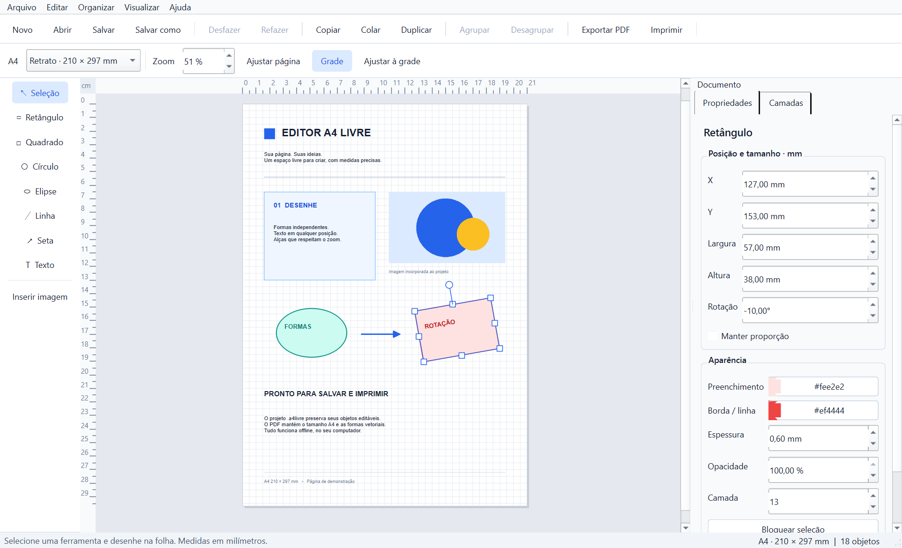

# Editor A4 Livre

Editor visual de uma página A4 para Windows, desenvolvido com Python e PySide6.
Crie formas, textos e imagens, ajuste medidas em milímetros e salve projetos
editáveis ou PDFs vetoriais em tamanho real. O aplicativo funciona **100% offline**,
sem conta, servidor ou banco de dados.



## Executar o pacote Windows

Extraia o ZIP `EditorA4Livre-Windows-x64.zip` e abra `EditorA4Livre.exe`.
Mantenha a pasta `_internal` junto do executável; ela contém Python, Qt e as
dependências. Não é necessário instalar Python para usar esse pacote.

O exemplo `examples/demonstracao.a4livre` pode ser aberto e editado no aplicativo.

## Instalação pelo código-fonte

Ambiente validado: Windows, Python **3.14.5 de 64 bits**, PySide6 **6.12.0**.
O código requer Python 3.12 ou superior e as dependências compatíveis da versão
escolhida. O download de dependências exige internet apenas durante a instalação.

No PowerShell, dentro da pasta do projeto:

```powershell
py -3.14 -m venv .venv
.\.venv\Scripts\python.exe -m pip install -r requirements.txt
.\.venv\Scripts\python.exe main.py
```

Também é possível abrir um projeto pela linha de comando:

```powershell
.\.venv\Scripts\python.exe main.py "C:\Projetos\cartaz.a4livre"
```

## Como usar

1. Selecione uma ferramenta à esquerda e arraste na folha.
2. Selecione o objeto e use suas oito alças para alterar as dimensões.
3. Segure **Shift** para preservar proporções. A alça circular gira o objeto;
   Shift durante a rotação ajusta o ângulo em passos de 15°.
4. Digite X, Y, largura, altura e ângulo no painel direito. As distâncias são em mm;
   as réguas são em cm. O zoom não altera medidas.
5. Dê duplo clique no texto para escrever. **Esc** encerra a edição. Fonte, tamanho,
   cor, negrito, itálico, sublinhado e alinhamento se aplicam à caixa inteira.
6. Use Ctrl+clique ou arraste no fundo para seleção múltipla. O menu **Organizar**
   oferece alinhamento, distribuição, agrupamento e ordem de sobreposição.
   A distribuição espaça uniformemente os centros dos objetos selecionados.
7. Na aba **Camadas**, dê duplo clique para bloquear ou desbloquear um objeto.
8. Salve em `.a4livre` para continuar editando ou exporte PDF para compartilhar.

Textos e formas são independentes. Aumentar uma forma não altera a fonte de um texto
sobreposto. Redimensionar a caixa de texto altera a quebra de linhas, sem ampliar
a fonte. Conteúdo que exceder a altura da caixa é recortado. Grupos são escalados
proporcionalmente, incluindo a aparência de seus filhos.

As imagens são incorporadas ao projeto. Preservam a proporção por padrão, opção
que pode ser desativada no painel. Quadrados e círculos podem ser deformados para
retângulos e elipses. Objetos podem ultrapassar a folha; o PDF recorta no limite A4.
Ao mudar a orientação, posições e dimensões são preservadas.

### Atalhos

- Arquivo: Ctrl+N novo, Ctrl+O abrir, Ctrl+S salvar, Ctrl+Shift+S salvar como.
- Edição: Ctrl+C copiar, Ctrl+V colar, Ctrl+X recortar, Ctrl+D duplicar, Delete excluir.
- Histórico: Ctrl+Z desfazer, Ctrl+Y refazer; uma entrada por gesto completo.
- Seleção: Ctrl+A seleciona tudo; Ctrl+G agrupa; Ctrl+Shift+G desagrupa; Ctrl+L bloqueia.
- Setas movem 1 mm; Shift+seta move 10 mm.
- Ctrl+I insere imagem; Ctrl+E exporta PDF; Ctrl+P imprime.
- Ctrl+roda altera o zoom; Ctrl+0 ajusta a página à janela.

Dentro da edição de texto, copiar, colar, recortar, excluir, selecionar tudo e
desfazer/refazer atuam sobre o texto. O histórico do documento recebe a edição
quando você sai da caixa.

### PDF e impressão

O PDF contém apenas o conteúdo da página: não inclui grade, réguas, guias, alças
ou fundo cinza. QPdfWriter desenha os elementos vetoriais; pypdf normaliza a caixa
física A4, corrigindo o arredondamento do Qt sem rasterizar ou escalar o conteúdo.
As imagens permanecem rasterizadas e os textos usam as fontes disponíveis no sistema.

A impressão usa o diálogo padrão do Windows. Depois de escolher a impressora,
selecione **Tamanho real · 100%** ou **Ajustar à área imprimível**. Em tamanho real,
impressoras sem suporte a impressão sem bordas podem recortar conteúdo das margens.
Confira também se o driver não aplica outro ajuste de escala.

## Testar

```powershell
.\.venv\Scripts\python.exe -m pip install -r requirements-dev.txt
New-Item -ItemType Directory -Force build | Out-Null
.\.venv\Scripts\python.exe -m pytest -q --basetemp=build/pytest-temp
```

Os testes exercitam mouse em uma janela Qt, alças, rotações, zoom, texto, agrupamento,
histórico, validação de arquivos, escrita atômica, imagens incorporadas e medidas
vetoriais no PDF. A pasta indicada em `--basetemp` é temporária e gerenciada pelo pytest.

Para gerar uma página de demonstração e uma captura da interface:

```powershell
.\.venv\Scripts\python.exe scripts/visual_check.py build/visual-check
```

## Gerar o executável Windows

```powershell
.\.venv\Scripts\python.exe -m pip install -r requirements-dev.txt
powershell -ExecutionPolicy Bypass -File .\build_windows.ps1
```

O script executa os testes antes de chamar PyInstaller, verifica o próprio executável e produz
`dist/EditorA4Livre/EditorA4Livre.exe`. Distribua **a pasta inteira**.
Parâmetros opcionais: `-Python CAMINHO_DO_PYTHON`, `-Output PASTA` e `-SkipTests`.
O build isola o PATH para não incorporar DLLs incompatíveis de outras ferramentas
instaladas no computador. O autoteste do executável roda mesmo com `-SkipTests`.

Autoteste do pacote, sem interação ou rede:

```powershell
$process = Start-Process -FilePath .\dist\EditorA4Livre\EditorA4Livre.exe `
  -ArgumentList '--smoke-test', 'build/smoke-package' -WindowStyle Hidden -PassThru -Wait
Get-Content .\build\smoke-package\smoke-report.json
```

O relatório deve conter `"ok": true` e o processo deve retornar código zero.
O teste cria uma janela fora da tela e exercita redimensionamento pelo mouse,
desfazer/refazer, salvar/reabrir e exportar PDF no próprio executável.

## Organização do código

- `editor/project`: modelos de dados e serialização validada com escrita atômica.
- `editor/geometry.py`: cálculos de redimensionamento e transformações.
- `editor/items`: pintura dos objetos e edição de texto.
- `editor/canvas.py`: página, réguas, grade, seleção, alças e gestos.
- `editor/controller.py` e `editor/commands`: operações e histórico por transação.
- `editor/main_window.py` e `editor/properties_panel.py`: interface Qt Widgets.
- `editor/export`: renderização compartilhada para PDF e impressão.
- `tests`: testes automatizados; `scripts`: geração de evidências visuais.

O JSON usa versão 1, uma lista ordenada de objetos e grupos recursivos; as posições
dos filhos são relativas ao grupo. Coordenadas X/Y representam a origem local do
objeto; a rotação ocorre visualmente em torno do centro. Não há execução de código,
HTML remoto, scripts, fontes baixadas ou recursos externos em arquivos de projeto.

Limites de leitura: 100 MB por projeto, 25 MB por imagem, 40 megapixels por imagem,
5.000 objetos e profundidade máxima de 20 grupos. Versões desconhecidas, IDs duplicados,
números não finitos, imagens inválidas e estruturas incompatíveis são rejeitados.
O histórico mantém até 150 operações. Nenhum dado é enviado à rede pelo aplicativo.

## Estado e licença

Consulte `RELATORIO.md` para resultados efetivamente executados e limitações de
validação. A especificação original está em `ESPECIFICACAO.txt`.
Nenhuma licença de distribuição foi escolhida para o código deste projeto.
As dependências mantêm suas próprias licenças; o pacote contém suas informações
em `third_party_licenses`.
